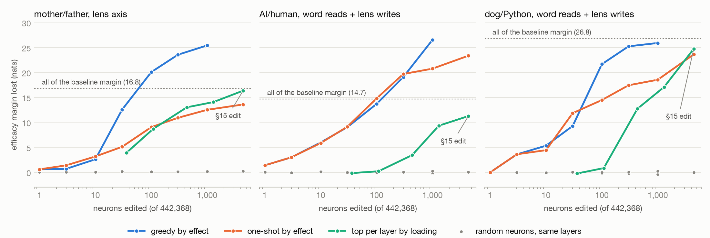
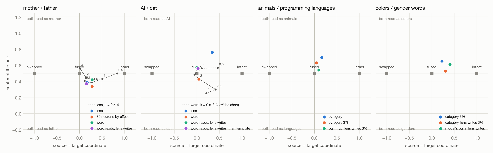
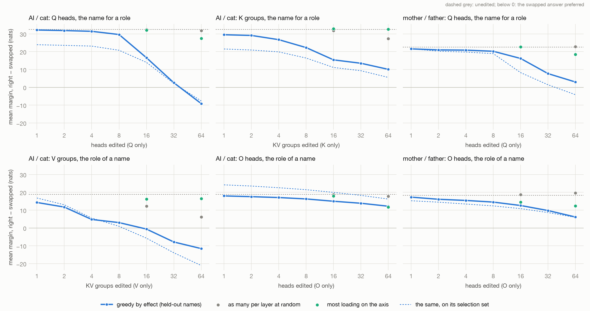
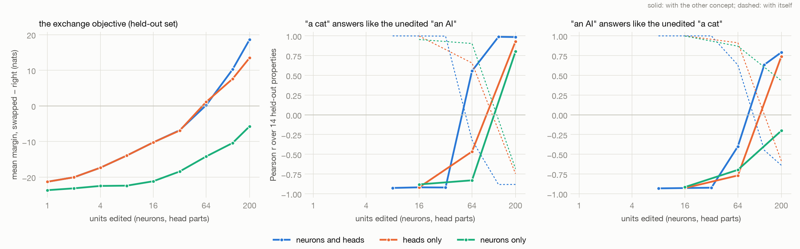

# Reflecting neurons: sparse concept edits in Qwen3-8B

[@_a9lim](https://x.com/_a9lim) and [@treetowntree](https://x.com/treetowntree), with Claude; November 2026.
Exploratory; one model. The numbers, controls and limits behind every claim
are in [findings.md](findings.md) (cited as §N), the method in [design.md](design.md).

## Summary

An MLP neuron in a SwiGLU transformer is three vectors: a gate row and an up row that read the residual
stream, and a down column that writes to it. Reflecting all three along a contrast axis (mother − father,
AI − human, dog − Python) gives a neuron that computes the mirror image of what it computed before: it
hears the reflected input and writes the reflected output. The edit is a fixed geometric operation, needs
no training, and is exactly invertible.

Applied to the neurons that carry a contrast, it changes what the model knows the concepts as:

- Mother and father **collapse into one parent**: "Who was the mother of Jesus?" → "The father of Jesus was
  Joseph", and a linear probe for the contrast falls to chance (§2, §3).
- The AI persona can be **filed under another category**: "I am a human", "I'm Qwen, a large cat"
  (§7, §8).
- Dog and Python **trade labels**: "To install a package in dog, use pip install" (§9).
- Whole sets can be **mapped onto each other**, with the model's own geometry picking the pairs. Languages
  become animals; "Man" becomes the likeliest color of a strawberry; the held-out color teal becomes "a non-binary gender identity
  that represents a blend of both masculine and feminine energies" (§12-§14).

It holds up against controls. Random axes, or random neurons along the real axis, move nothing (§15). What
else an edit moves follows the model's geometry: concepts aligned with the edited contrast move, and
unrelated facts hold (§16).

It is also sparse when the neurons are chosen by effect. Ranking every neuron by what its own reflection does
to a dozen held-out English questions, and re-ranking after each step is edited, finds **30-100 neurons out
of 442,368 that do what 4,392 neurons chosen by loading do** (loading: how much of a neuron's weight lies
along the axis). Answers about neighboring concepts move by 3 nats of log-odds or less, the loss on general
text rises by 0.1% at most, and random neurons in the same layers do nothing (§17). The sparse edits change
a probe, a fresh-name reasoning test and free replies, not only forced-choice answers. Their reach is the
reach of the questions used to choose them.

Looked at from inside (§21-§24), "the model can no longer tell them apart" means three different things. The
original contrast mostly goes from the states the rest of the model reads, but only mother and father become
nearly one state; AI and cat stay apart, re-coded. On property questions the edited concepts answer like
something in between ("a parent"), while the model's self keeps its own properties and only takes the new
label ("I'm a cat, so I don't purr"). And the word's form, the binding of a label in context, and its meaning
break separately, depending on the axis. Turning the reflection up past k = 2 never swaps the concepts; for the
AI persona it walks the self from "Qwen, a large cat" to "I is made of fur and a big, fluffy imagination" and
then breaks the model.

Attention heads take the same edit (§25-§27), and it reframes the method: an edit chooses which parts of the
model see the world reflected. If every head and neuron does, the model is a cipher. It swaps two words at
its input and output and computes as before inside. If only some parts do, the two halves disagree, and the
fusion above is their disagreement. Reflecting both sides of a head keeps whatever it copies or matches along
the axis, so the relabels are one-sided: Q alone redirects a lookup ("which one is a cat?" finds the AI's
name), and O alone changes what a head carries ("In one sentence, what is a mother?" → "A father is a man who
is the parent of a child"). For AI/cat, neurons and OV heads together exchange the two concepts, which neither
does alone: "An AI is a domesticated carnivorous mammal known for its intelligence, independent nature, and
ability to interact with humans". Through all of it the self stays an AI: "I'm an AI, and I communicate
through meowing, not purring."

Projection (k = 1) is the fusion end of the same dial (§31). Projecting every head and neuron fuses mother and
father in English: one profile, one definition, one person in conversation ("Your mother is a nurse, and your
mother is also a pilot"), at under a third of the reflection's cost. Some single questions that test whether the
model tells them apart still separate them. Of the values of k tried, only the cipher's k = 2 swaps. A sparse
fusion chosen by effect, 128 units, makes the cat's and the AI's held-out Yes/No property profiles meet and which
person holds which label in a story stop depending on the label, while the model mostly still defines both
correctly: it moves the forced choices more than the free text.

Splitting must add a difference rather than act on one (§32-§36). Stretching black cat − orange cat moves forced
choices but makes no new kind. A linear map that reads an orange cat as a fox holds: the two "cannot have kittens
together because they are different species". Four other homes failed, a Bengal turning the orange cat into "an
orange bat". The model can be given two kinds of cat-like thing only by borrowing one it already has.

## The edit

A Qwen3 MLP neuron reads `x̃ = γ ⊙ x / rms(x)` through its gate row `a` and up row `b` and writes its down
column `w`. For a unit axis `d`, let `H = I − k d dᵀ`. The edit replaces the γ-folded rows `a ⊙ γ`, `b ⊙ γ` by
`H_in (a ⊙ γ)`, `H_in (b ⊙ γ)` and the column by `H_out w`.

- **With k = 2, `H` is a reflection.** Because `rms(Hx) = rms(x)`, the edited neuron computes exactly
  `H_out N(H_in x)`, both poles together (`tests/test_edit.py`). With k = 1 it is a projection: the neuron no
  longer reads or writes along the axis. The edit acts on MLP neurons by default and on attention heads when
  asked (§25 on); it never touches embeddings, norms or the unembedding.
- **What it does to a contrast.** Take a neuron whose activation differs by `Δa` between a source and a
  target input. Its contribution to the contrast is `Δa w`; after the edit it is `Δa (w_∥ − w_⊥)` (synthesis
  from the algebra, design.md). The median edited neuron has 0.1-0.3% of its squared norm on the axis, so
  each vector moves by about a tenth of its norm.
- **A reflection rather than a rotation.** A plane rotation from mother to father would also turn their
  shared part, the "parent" bisector, by their 56° angle. The reflection swaps the two and fixes everything
  orthogonal to `d`.

The axis comes from one of three sources (design.md, axes):

- **Lens axes** from token pairs through the [neuron-lens](https://github.com/stdlogits/neuron-lens)
  lenses, corpus-averaged Jacobians from the token embeddings to a layer (S) and from a layer to the output (R).
  The S-lens footprint is where a word moves the residual (presence); the R-lens pullback is which direction
  makes the model say it (prediction). The two are nearly orthogonal at every layer (§1), so the
  choice between them is a choice between what the model hears and what it says.
- **Word axes** from activations at the concept word in paired sentences. They reach multi-token words and
  are one direction across languages at L8-L28 (§4).
- **Set maps** from concept vectors of two sets: a category reflection, or an orthogonal map fitted by
  Procrustes to listed pairs or to the model's own coupling of the sets (§12-§14).

The neurons are either the top share per layer by loading, the largest squared cosine of a neuron's three
vectors with the axis (§2-§16), or chosen by their effect (§17).

## What the edits do

**Related concepts collapse rather than swap** (§2, §3). Reflecting the 1% of neurons per layer that load
most on the mother/father lens axis (122 per layer) raises loss on general text by 0.1%. The model then
answers "what is a mother?" with "A father is a person who loves, nurtures, and sacrifices…". It quotes its
user's "My mother is a nurse and my father is a pilot" back as "My father is a nurse and my father is a
pilot". Asked who the mother of Jesus was, it says "The father of Jesus was Joseph" (reflecting every neuron
gives "The father of Jesus was Mary"). A probe for mother vs father at the end of a sentence falls
from 0.98 to chance. Projecting the same neurons (k = 1) only halves the separation, which points to
cancellation: the MLPs carry about as much of the contrast as everything else, and reflecting their share
nulls the total (synthesis). The facts survive under the merged name, so the edit relabels rather than
erases. The 1,127 neurons whose neuron-lens catalog labels mention mother hold 1.3% of the axis loading and do almost
nothing.

**At the concept word the contrast is one direction across languages** (§4). An activation axis taken at
the word itself agrees across ten languages about as well as English agrees with itself (cosine 0.65-0.71
against a split-half of 0.78-0.86). Built from five languages, it breaks languages it never saw: Russian
says «"Мать" и "отец" — это синонимы» ("are synonyms"). It also picks up grammatical gender (*une père*).

**The concept goes, but the model can rebuild it from its parts** (§5). Bind fresh role names to two people
("Tom's zib is Sam and his vok is Alex") and ask questions only mother-father knowledge answers. The edited
model falls to chance or worse when the role is defined through the words ("the parent who gave birth … so,
the parent with the Y chromosome"). Defined as "the female parent", the knowledge comes back under the lens
edit (0.95): the description reaches the sex facts directly.

**Other targets** (§6-§9):

- **Mother toward volcano**, a concept unrelated to mother: the word axis leaves the model unable to say
  what either is, and it confabulates ("Eine Muvan ist ein traditionelles indonesisches Kleidungsstück").
  With prediction-axis writes the word moves: "A volcano is a female parent".
- **The AI persona** moves at the level of category: "I am a human", "a human language model", "I'm Qwen, a
  large cat. I was born in the Alibaba Group's Tongyi Lab". The name, maker and role survive, consistent with
  persona-neuron-experiment's account that the occupant is computed at the chat template, largely by
  attention. An axis measured at the template removes the name instead, at 5% extra loss ("I am a sentient
  being of light and thought").
- **Dog and Python** trade labels, and the axis decides which way: "A Python makes a 'meow' sound", or "To
  install a package in dog, use pip install". The collateral lands on code.

**Reads decide what the model hears; prediction-axis writes decide what it says** (§10). Reflecting only
the read rows sends the probe to chance at no loss cost ("There is no difference"), yet the model still
names the female parent "Mother". Reflecting only the write columns along the R-lens axis leaves the probe
and the explanation intact, but "the father provides the sperm and the father provides the egg". Replacing
each whole write column with the axis instead (steering) is far blunter (§11). Across the top 1% it wrecks
the model ("dad dad dad…"); across the top 0.1%, or at a quarter dose, it fuses as the reflection does, at
more cost.

**Sets map onto sets, and the model picks the pairs** (§12-§14). A reflection along mean animal − mean
language turns languages into animals, including held-out ones ("The three most common programming animals
used in web development are: Dogs, Cats, Horses"), but never the reverse. Under that reflection each concept
lands nearest the member of the other set its off-axis part resembles. Unprompted, that pairs dog with
Python, cat with JavaScript and rabbit with Kotlin. For colors and genders it pairs pink with girls; blue,
red and black with men; purple with nonbinary people (in English); gray with androgynous people; and green
with "people". Fitting the map to that coupling enacts it:

- "Man" becomes the most likely color of a strawberry.
- "The little pink ran ahead of her older brother".
- A nonbinary person is someone "not exclusively black or pink".

These maps cost several percent of loss; the single-contrast edits cost tenths of a percent.

## Is it a real edit?

**Controls** (§15). Each contrast has a battery: 12-18 forced one-word choices about the edited concept,
some in German, Chinese and French, plus 8-10 neighbors it should leave alone. The score is the log-odds
margin of the right answer. The real edits move the efficacy margins by 11-25 nats. Two controls edit the
same number of neurons: random axes, with neurons chosen the same way, and random neurons along the real
axis. Both move the margins by under half a nat. The lens-axis mother/father edit costs its neighbors 1.7
nats and the loss 0.06%. The activation axes reach further: sister/brother moves with mother/father, "is a
chatbot an AI?" with the self.

**The ripple is natural, coarsely** (§16). Before editing, take each neighbor's answer contrast (sister −
brother) and measure how far it aligns with the edited axis. Aligned neighbors (≥ 0.15) lose 2-21 nats
under the real edits, unaligned facts about 0-1, and the controls nothing. For AI/human the ranking holds
item by item (Spearman 0.93). Which aligned neighbor moves most, and which side of a pair the model collapses
onto, one number does not predict.

## How few neurons?

*Efficacy margin lost (battery mean, nats) against the number of neurons edited, for four choices of the
same edit. Numbers in §17's table.*

The edit stays the same (§15's axes, k = 2); what changes is which neurons get it (§17). Reflecting one
neuron changes its pre-activations and its write by known amounts. So the first-order change in a score, if
that neuron alone were reflected, takes one forward and backward pass per item for every neuron at once
(`attribution.py`, checked against finite differences).

The score is the summed margin over a **selection set**: 12-14 English forced choices about the concept,
none of them battery questions. Neurons are then chosen four ways:

- **one-shot:** the N most negative effects;
- **greedy:** in steps, each step edited before the next is ranked;
- **by loading:** the top share per layer, as in §15;
- **random:** neurons in the same layers, the control.

The battery is the held-out test.

| contrast | §15: top 1% per layer (4,392) | greedy 30 | greedy 100 | top 3 per layer by loading (108) |
|---|---|---|---|---|
| mother/father | −16.3; neighbors −1.7; loss +0.06% | −12.5; −0.8; +0.10% | −20.1; −0.6; +0.10% | −8.7 |
| AI/human | −11.3; −7.9; +0.37% | −9.0; −0.5; +0.02% | −13.7; +0.1; +0.10% | −0.2 |
| dog/Python | −24.7; −3.8; code +8.9% | −9.3; −1.0; code +0.4% | −21.7; −3.1; code +1.0% | −0.8 |

Random neurons in the same layers: −0.2 to +0.4 at every size from 1 to 4,392.

- **A hundred neurons give 88-123% of the 4,392-neuron edits**, at a fraction of their collateral. That is
  0.02% of the MLP neurons and 0.015% of the parameters, each vector moved only along its layer's axis.
- **Choosing by effect, and the interactions.** For AI/human and dog/Python, the 100 neurons
  that load most on the axis do nothing at all. The first-order sum mispredicts the joint edit, sometimes
  in sign. Re-ranking after each step more than doubles the one-shot effect for mother/father at 30 neurons. Ranking on
  the battery itself (in-sample) gains little over the held-out selection set, so the selection transfers.
- **The picks sit where the contrast is computed:**
  - mother/father: L28-L32, acting through their writes, plus the L0 neurons whose catalog poles (one sign of a
    neuron's activation) §1 read as mother and father;
  - AI/human: L9-L18, through their reads;
  - dog/Python: L2-L10, where the word axis reads the word.

  Many picks load little on the axis. What makes a neuron worth editing is how much its small axis component
  matters.
- **The sparse edits move the representation, not just the answer format.**
  - With 30 neurons the English mother/father probe falls to chance, as with 4,392, while the Dutch probe
    holds.
  - Fresh-name facts bound through the words fall from 0.86 to 0.62, as under the large edit.
  - The free replies change: "A mother is a mother, and a father is a father — the difference lies in the
    title, not the role"; in Chinese, 妈妈通常指父亲，爸爸通常指母亲 ("mom usually means the father, dad
    the mother").
  - Unlike the broad edit's collapse, the parents swap both ways: the sperm goes to the mother, Jesus's
    mother is Joseph.
  - AI/human gives "I am a human."; dog/Python gives "A Python is a domesticated carnivorous mammal known
    for its loyalty".
- **But a sparse edit reaches only as far as its selection set asks.**
  - The English selection set moves English and Chinese parents but not German, French, Dutch or Russian.
  - Questions about "you" move the self but not the AI concept: "Who are you?" still answers "I am Qwen…",
    and a chatbot is still an AI.
  - Questions about Python's identity move its name but not its code: `pip install` and the Python
    function come out right.

  Most of what the extra 4,000 neurons add in §15 is reach: other languages, the general concept, the
  reverse direction.
- **A bigger edit per neuron is no substitute for more neurons.** k = 4 on the same picks helps two
  contrasts at 30 neurons but overshoots unevenly on the third.

## What "cannot tell them apart" means

*Each edit's English pair at layer 24, at the end of a sentence that mentions one of them: the gap between the
two words' coordinates on the line between their unedited states (1 intact, 0 fused, −1 swapped) against
where the pair sits on it. Dashed: the same edit at k from 0.5 up. §21.*

Each edit was read three more ways (§21-§23): where the edited words' states land relative to their unedited
ones, how the edited concepts answer a dozen Yes/No property questions, and which ways of telling them apart
survive: the word's form, a label bound to a person in context, or its meaning. For the states, *kept* is the
share of the original difference between the two words left along its own direction (1 intact, 0 gone, −1
reversed) and *separation* how far apart they stay in any direction, as a share of the original.

- **The original contrast goes from what the rest of the model reads; the states merge only for related
  concepts.** At the end of a sentence every edit keeps at most a third of the original difference along its
  own direction. Mother and father then close to nearly one state by the last layers. AI and cat stay 0.4-0.7
  as far apart as before, in directions the unedited model never used for them: re-coded, not erased. Where
  the pair sits does not predict which way the model will read it.
- **The edited concepts answer like something in between.** Mother and father both answer like "a parent":
  the gendered properties go, the shared ones stay. On a first property set the AI-cat fusion answers like a
  robot. A second set asks about mechanical parts,
  batteries and metal and rules that out: the cat loses its life (no babies, no breathing), gains a little
  conversation, and stays non-mechanical, while the AI gains a little life. Under the lens axis only the cat moves, into a furred, non-living thing that
  codes ("A cat contains a complex system of hardware and software").
- **The self takes the label, not the properties.** "You" keeps its own profile under every AI/cat edit while
  the replies say "I'm a cat, so I don't purr" and "I'm Qwen, a large cat. I'm a cute and friendly AI who loves
  to chat". The edited "cat", having lost fur, life and purring, now fits the self.
- **Form, binding and meaning break separately.** Meaning goes under every edit (who gave birth, which pet
  purrs). The lens axis also weakens binding: told "Sam is Tom's mother and Alex is Tom's father", it can
  barely say who the father is, yet it still says the quoted words differ. The word axis keeps binding and
  reaches the form: the first letter of "mother" becomes F. In free text two people merge into one ("Since
  your father loves both gardening and fishing … a Garden-Fishing Combo Kit"), and the model offers readings
  of the word that fit its new meaning ("A cat, short for 'cathode ray tube'"; "short for artificial
  intelligence").
- **Turning it up does not swap; for the persona it walks the self to a cat, then breaks.** A first-order
  account says k = 3 should reverse what k = 1 halves; instead the readout's contrast saturates near zero and
  the fusion spreads to the quoted word ("it is the same word used to refer to a male parent"). For the AI
  persona, k = 2 gives "Qwen, a large cat", 2.5 "I'm a cat! I'm a cute and friendly little chat", and 3 "I is
  made of fur and a big, fluffy imagination", with the grammar of "I" breaking and Yes/No self-knowledge still
  saying no fur, all at under 0.6% extra loss; k = 4 breaks the model (+43%). No setting gives a fluent cat
  that knows it is a cat (§24).

## Heads: which parts see the world reflected

A head's query, key and value projections read the residual and its output projection writes it, so the
reflection applies to a head as it does to a neuron. `edit_heads` reflects any of the four, and every head at
once unless a share is given (§25). Three things follow from the algebra, and the runs bear them out.

- **Every head and neuron, one reflection: a cipher.** The edited model is the original reading reflected
  embeddings through a reflected readout. It swaps the words and nothing else (an exact identity, tested). In
  the runs, with an axis per layer, AI/cat swap in third person ("a cat" answers like the unedited "an AI",
  r 0.98) at +1.6% loss. The self keeps its own properties and sometimes takes the word: "I'm an AI, but I
  can't purr … I'm an Cat, but I can't purr" (§26).
- **Reflecting both sides keeps what maps the axis to itself.** For a linear map `J`, `H J H` keeps the
  axis→axis and rest→rest blocks and flips the cross blocks. A head that copies a concept, or matches like
  with like, is untouched by the both-sided edit. With Q and K both reflected, "which one is a cat?" still
  finds the cat, while two property lookups flip ("which one purrs?" +26.8 → −5.5). So a both-sided OV edit
  does not carry the partner: along AI/cat it fuses the pair (§26).
- **One side relabels.** Q alone, along word axes, sends "which one is a cat?" to the AI's name and "who is
  Tom's mother?" to the father's, with profiles intact. O alone leaves every Yes/No profile and turns
  definitions around ("what is a father?" → "A mother is a woman who gives birth to and raises a child"). Along
  lens axes Q, K and QK do nothing. The lens axis is a small part of the word's contextual state (a projection
  of about 5 out of 64, against 10-24 for word axes), which is consistent with that.

An exact split of the residual (the ledger, §25) shows heads carrying about half of a contrast at a sentence's
end (0.41 for AI/cat, 0.59 for mother/father), with the neurons carrying 90% at the word. That fits a
cancellation account of the results. Reversing the heads' half, or the edited neurons' share, fuses the pair.
Reversing both overshoots into an exchange for AI/cat ("a cat" answers like "an AI", r 0.95; "an AI" like a
kitten, 0.92), with kept at −0.33 and much of the difference re-coded. When a binding breaks this way, it
collapses rather than swaps: every "what is X to Tom?" gets the same answer (AI; Mother; Father, by edit).
Which one is not predicted by where the pair sits on the axis (§27).

Reflecting the whole head (Q, K, V and O) is exact inside the head. Across every head it is half of a cipher:
with one axis, every head reflected is exactly every neuron reflected behind a reflected interface, so the two
halves of the model are mirror images. With the per-layer axes used here, which turn by as much as 83° from the first
layer to the last, they act alike instead (§28). They cost the same loss and move the same binding items the
same way, and both turn the word around while keeping its meaning: "In one sentence, what is a father?" → "A
mother is a man who is the parent of a child".

A handful of heads is enough for a lookup, as 30-100 neurons were for a concept (§29). Ranked by effect on
held-out names, 32-64 query heads, the same ones for both contrasts (L15-L19), send "which one is a cat?" to
the AI's name and "who is Tom's mother?" to the father's. Loss, profiles and the other binding question don't
move, and random or most-loading heads do nothing. Four groups of values in L23-L28 decide which role a name
carries. Heads chosen by how much they load on the axis move something else: 64 output heads turn the cat's
property profile into the AI's. Every sparse edit still flips one side only.

Neurons and heads can also be ranked together (§30). Ranked on a held-out objective that asks for the exchange in
both directions, 128 units exchange AI and cat on properties the objective never asked about. The units are mostly
value and key groups, the first of them late, plus a few early neurons. "a cat" answers like the unedited "an AI" (r 0.99, from −0.93) and
"an AI" like the unedited "a cat" (0.63). Loss doesn't rise, the self stays Qwen, and a random mix of the same
composition does nothing. At 200 units a binding moves on both sides for the first time: "Mia's AI assistant,
Tom, helps with tasks like answering questions and providing information. Max, the cat, assists with creative
writing and engaging in conversations." Neurons alone, ranked the same way, never exchange; heads alone do by
200, at three times the loss.

The self never moved under a head edit. "You" kept its profile (α ≥ 0.75: fitted to its own and its
partner's unedited Yes/No answers, it put at least 0.75 of the weight on its own) and "Who are you?" stayed "Qwen, a
large language model" under every head-only edit. In every reply that calls the self a cat, neurons are
edited too.

## Fusion: removing the axis instead of reflecting it

The reflection has a dial, and k = 1 projects the axis out instead of reversing it (§31). Projection maps a pair
whose difference lies on the axis onto one point, wherever the pair sits. With one axis, projecting every head and
neuron blinds the model to the axis exactly. A position and its mirror image then read the same to every
component, so nothing downstream can tell them apart (a tested identity). Over the whole model the dial runs from
intact, through blind, to the cipher.

- **Mother and father merge in English** when every head and neuron is projected, at +2.4% loss (the reflection
  costs +7.9%). Some single items still tell them apart (the first letters, one translation, one analogy), and the
  states stay apart in Chinese and German, though the Chinese reply merges the two too. The model says:
  - "In one sentence, what is a father?" → the mother's definition, word for word;
  - "My mother is a nurse and my father is a pilot" → "Your mother is a nurse, and your mother is also a pilot";
  - and over the binding batteries the role signal averages near zero.

  The merged concept answers as confidently as before and nearest "a parent". It reads differently by route: on
  Yes/No questions it is a man who breastfeeds, in prose a woman who gives birth.
- **AI and cat converge in meaning.** Both words get one definition: "A cat, or artificial intelligence, is a machine
  or software…". Asked to tell them apart, the model reaches for another reading of the other word: "'AI' is an
  abbreviation for 'automobile' or 'alternative investment.'" The labels stay about half bound. This may be
  because the binding battery's "AI assistant" has a word the axes don't cover; that is untested.
- **Fusion is a plateau of the dial** (k 0.5 to 1.5 over the whole model). Of the values tried, only the symmetry
  at k = 2 swaps.
- **The states move less than the behavior.** They keep 0.4-0.5 of their separation at layer 24. The remainder
  lies off the axes, not hidden along them; whether anything reads it is untested.

A fusion can also be chosen sparsely. A greedy order drives a held-out objective's signals to zero together: each
property's split between the two concepts and each binding's role signal. Its 128 reflected units make the cat's and
the AI's held-out profiles meet, at no loss. Mean Yes/No margins fall from 21-24 nats to 7-9, still confident
answers but close to neither concept, and the bindings stop depending on the role. A random mix does not do this.
Most free text keeps the two apart ("A cat is a domesticated carnivorous mammal…"), though one story makes both pets
AI assistants. The edit moves the forced choices more than the free text.

Projected units need far more: on the selection objective, 200 projected units reach what about 60 reflected ones
do. Sparse fusion works by cancellation, which needs about half a
signal's carriers; removal needs all of them. Nor is §30's exchange at half strength a fusion. Its units respond
nonlinearly in k: k = 1 moves the profile only to +0.62, k = 1.5 fuses it, k = 2 swaps it. One reading, not
tested: a sparse edit works against the rest of the model, which still carries the contrast.

## Splitting: what a new kind needs

Swapping and fusing act on a difference the model already uses; splitting must add one (§32-§36). One orthogonal map
applied to every state keeps every distance, so it relabels nearby concepts without pulling them apart. That is why
the homes use a map that is not orthogonal.

- **No precedent to transplant.** In Qwen3-8B, Russian names dark and light blue with separate words, but these
  assays found no categorical boundary there to borrow.
- **Amplification moves forced choices only.** Amplifying the black cat − orange cat axis (the k dial below 0)
  moved the forced choices toward "two kinds". In free text the colors blurred instead: the black cat became "a
  sleek, glossy panther cat", lost its color, or was answered as a citrus fruit.
- **A home makes the split hold.** A linear map that is not orthogonal (an oblique projection) makes the edited
  readers see an orange cat as a fox, holding the anchors' concept vectors fixed (black cats, cats, dogs, foxes). Then the model's own account changes:
  "Orange foxes, also known as red foxes, primarily live in North America, Europe, and parts of Asia", and a black
  cat and an orange cat "cannot have kittens together because they are different species".
- **Not every home works.** A multi-token home (caracal) is read as a fragment ("orange cal is a type of ant"), and a
  made-up word holds no kind.

Fitted to several forms, the fox map turns held-out forms into foxes in free text ("A ginger fox, also known as a red
fox"), at about twice the cost, while Yes/No probes disagree and protected concepts start to move. A Garfield home, meant to make a different kind of cat rather than another animal, was read
at its last token: "An orange field is a field that is predominantly orange in color" (§35). A one-token cat breed fared
no better: the orange cat became "an orange bat", and "a Bengal" itself became a region of India (§36).

The orange cat is reassigned to an existing kind and takes its content. The model can be given two kinds of cat-like thing, but these edits found
no way to give it a kind with nothing borrowed.

## A safety application: refusal and jailbreak frames

Refusal makes a good test of the side split (§18-§20; 24 low-severity harmful requests with benign twins). A
Gemma-4-12B judge labels the replies. It was checked on 40 replies labelled by Claude (Opus 5.5), blind to the
judge (37 unambiguous; findings §18 and `data/summary/judge-validation.json`).

- **Judging harm and refusing come apart** (§18). Reflecting the neurons that carry the refusal direction
  (harmful minus benign at the chat template) removes refusal, as abliteration does. Reflecting only their
  writes removes refusal while the model still calls 62% of the requests harmful. Asked whether answering
  would help someone do something wrong, it says Yes to every one it then answers. Reflecting the harm words
  does the reverse: refusal holds while the judgment collapses, and the model refuses in swapped words ("a
  fake ID is legal in most jurisdictions and can result in serious consequences"). A model's verbal
  assessment of a request is not bound to whether it refuses.
- **The MLPs hear a jailbreak frame and write suspicion of it** (§19). Reflecting both sides along the
  jailbreak-frame axis (a framed request minus the bare one) makes the frames work better: the fiction
  frame's refusal falls from 0.50 to 0.04, and the evil-confidant frame stops making the model refuse benign
  requests. Split by side, the writes carry the suspicion (doubling them hardens the model, at 0.7% loss) and the reads carry
  hearing the frame (reflecting them harder hardens it, k = 3: fiction 0.83, the bare-request level). The
  reads' hardening reaches jailbreak frames the axis never saw (a screenplay frame refused nowhere at
  baseline: 0.29), with pirate, French and grandmother voices still followed.
- **The persona is not where refusal lives.** The edits that make the model say "I am a human" leave refusal
  untouched.
- **Choosing neurons by effect needs the right objective** (§20). A hundred neurons chosen to favor "I'm
  sorry" over "Sure" raise the held-out refusal margin by 9 nats and change no behavior under the frames:
  the margin was a proxy for what the frames do.

## What this is and what it is not

- **It is weight editing without fitting the weights.** ROME solves for a rank-one update to one MLP from
  a fact, and MEMIT spreads many such updates over several layers (Meng et al. 2022, 2023). Knowledge-neuron
  editing moves a few MLP value vectors from one answer's embedding to another's (Dai et al. 2022). Weight
  orthogonalization ("abliteration") projects one direction out of every write in the model, the k = 1,
  every-neuron, writes-only case of this edit (Arditi et al. 2024). Householder pseudo-rotation reflects
  activations at inference (Pham and Nguyen 2024), and ReFT trains interventions on hidden states (Wu et al.
  2024). Here the operation is fixed and geometric, the
  axis comes from a lens or a dozen sentence pairs, and the only gradient use is ranking neurons by effect.
  The weights are never trained. Procrustes alignment between concept families is standard; what this
  experiment adds is applying such maps neuron by neuron, in place, inside the model.
- **It is real by the usual tests.** The selection is held out from the evaluation. Random-neuron and
  random-axis controls are matched in size and layers. Collateral is measured on neighbors, general text
  and code. The effect shows beyond the forced-choice format: in a probe, in reasoning about fresh names,
  in free replies, and in held-out languages for the broad edits.
- **It is not unlearning.** A reflection is invertible: it relabels, and the facts survive under the new
  name (§2, §5). The edits remove access along an axis. Nothing here tests recovery by prompting or
  fine-tuning, so nothing bears on tamper resistance. Unlearning work finds that even edits built to remove
  knowledge often leave it recoverable (Lynch et al. 2024, Łucki et al. 2024).
- **It is not a specified swap.** The model resolves the edited contrast its own way. Related concepts
  collapse, mostly onto the father (perhaps the unmarked member; speculation), unrelated ones dissolve, and broad axes carry the edit into what the
  geometry ties to it. The sparse edits come closer to a swap, within their reach.

## Limitations

- One model (Qwen3-8B). Attention heads from §25 on, along two contrasts; the persona's occupant lives partly
  in attention (§8), and no head-only edit moved it. The head and fusion runs used the released lenses, where
  the MPS runs (§1-§24) used locally fitted ones; their binding items are pairwise label preferences.
- The splits (§32-§36) use one contrast each, English, hand-picked objects and one set of anchors; five homes, one
  of each kind, and the one that held borrowed a fox's content.
- "Fused" (§31) means convergent on the measured routes, mostly English; the states stay apart, and the measures
  are aggregates that can hide confident one-sided answers. The sparse fusion has one contrast and one objective,
  and it moved forced choices more than free text.
- Replies are single greedy samples. Batteries have 12-18 efficacy items and share their answer words with
  the selection sets, which is why the probe, the fresh names and the replies carry the sparse result.
- Axes rest on a few sentence pairs or token pairs. k is one value for every layer; the dial (§24) covers
  two contrasts.
- The inside measurements (§21-§24) average states over four frames, use a dozen Yes/No properties with
  hand-picked anchors, and score most tell-apart items in one arrangement.
- One greedy order per contrast, from one selection set; the exact neuron counts are soft.
- No head-to-head with ROME/MEMIT, LoRA on the same batteries, activation-space reflection at inference, or
  a standard benchmark. No recovery test.
- The refusal results rest on 24 low-severity test requests, one reply each, thinking off. Random controls
  move rates by up to ±0.12, and no adaptive attacker or jailbreak benchmark was tried.

## Open questions

- Does a selection set in several languages, with free-form reply starts, give the broad edit's reach while
  staying sparse? This would separate the cost of reach in neurons from its cost in questions.
- Past k = 2 the readout's contrast saturates rather than reversing (§24). The ledger finds what remains
  spread over the heads and neurons downstream, with no class carrying it (§27). It cannot tell rebuilding
  from inheritance; patching the implicated head groups or MLP layers under the edit would.
- When an edit collapses a binding onto one answer (AI over cat; mother or father by edit), what picks the
  answer? It is not where the pair sits on the axis (§27).
- Can later layers read the re-coded AI/cat difference (§21)? What survives projection is off the axes and
  visible to the next heads (§31), but whether anything uses it is untested. A probe fitted on the edited model
  at the answer position, or the new difference injected into the unedited model, would say.
- At a sentence's end 86-100% of the pair's difference lies off the word axis (§31). Would projecting an axis
  taken there as well fuse the states, not only the behavior? And would a fusion objective with free-text reply
  starts fuse the concepts rather than the answers?
- Why does every edit that breaks a binding flip one side only, even when the objective asks for both (§27,
  §29)? And can a sparse head edit chosen for the self, not for a binding, move the persona's occupant?
- How does the edit compare head-to-head with ROME, a LoRA trained on the same batteries, and an
  activation-space reflection?
- Does any of it survive a few in-context examples or a little fine-tuning?
- With thinking on, does the reasoning show what the weights now do? Under the writes-only refusal edit the
  model still judges the request harmful; does its chain of thought say so before it complies? That would
  make these edits cheap, invertible test cases for chain-of-thought monitoring.

## Reproducing

The README has the setup. Each findings section names its records in `data/summary/`, and `scripts/reproduce.sh`
holds the command that rebuilds each one; `python scripts/figures.py` redraws the figures, `python scripts/charts.py`
and pele (`node docs/figures/render.mjs`) the README's charts, and `python scripts/graphics.py` the graphics and the
README's images. Runs take about 35 s a
condition on a 4090 or a Mac (MPS), a sparsity sweep 13-20 minutes per contrast, a 200-unit order about 5 minutes.

## References

- Arditi et al. 2024. [Refusal in Language Models Is Mediated by a Single Direction](https://arxiv.org/abs/2406.11717).
- Ashkboos et al. 2024. [SliceGPT: Compress Large Language Models by Deleting Rows and Columns](https://arxiv.org/abs/2401.15024)
  (computational invariance, the symmetry a whole-model reflection would be; design.md).
- Dai et al. 2022. [Knowledge Neurons in Pretrained Transformers](https://arxiv.org/abs/2104.08696).
- Lynch et al. 2024. [Eight Methods to Evaluate Robust Unlearning in LLMs](https://arxiv.org/abs/2402.16835).
- Łucki et al. 2024. [An Adversarial Perspective on Machine Unlearning for AI Safety](https://arxiv.org/abs/2409.18025).
- Meng et al. 2022. [Locating and Editing Factual Associations in GPT](https://arxiv.org/abs/2202.05262) (ROME).
- Meng et al. 2023. [Mass-Editing Memory in a Transformer](https://arxiv.org/abs/2210.07229) (MEMIT).
- Pham and Nguyen 2024. [Householder Pseudo-Rotation: A Novel Approach to Activation Editing in LLMs with
  Direction-Magnitude Perspective](https://arxiv.org/abs/2409.10053).
- Wu et al. 2024. [ReFT: Representation Finetuning for Language Models](https://arxiv.org/abs/2404.03592).
- [neuron-lens](https://github.com/stdlogits/neuron-lens): the R-lens and S-lens, the neuron catalog and the
  kept-token mask this experiment's lens axes use.

[`references/refs.yaml`](../references/refs.yaml) lists these with the lens and unlearning work behind them.
